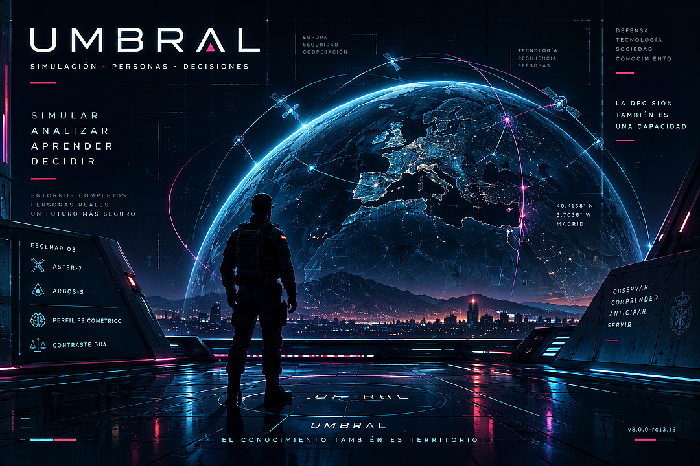

  

# UMBRAL

¿Que es UMBRAL?

UMBRAL es una herramienta de perfilado profesional y humano gamificado con juegos para medir el desempeño en la dirección y gestión de proyectos cada sector.

El monolito presenta proyectos en los que el participante debe decidir con información incompleta, recursos limitados y responsabilidades concretas. La versión 10 y posteriores enlazan el cuestionario de perfil, una muestra de trabajo en BID-1 y una ficha de entrevista que identifica qué se observó y qué queda por comprobar.

La aplicación funciona en un único fichero HTML, sin instalación ni servidor. Está destinada a formación, demostración, pruebas y revisión del diseño de la evaluación. No está validada para tomar decisiones de contratación, diagnosticar rasgos psicológicos ni clasificar personas de forma automática.

## Guía rápida

1. Descarga `index.html` y ábrelo como archivo local en el navegador o accede directamente a la url https://mhg778.github.io/umbral/ . No uses la vista previa del repositorio o de un servicio de almacenamiento. Utiliza datos ficticios para explorar el prototipo.
2. Para practicar, elige un escenario en el portal. Selecciona la modalidad temporal antes de empezar. Si aparece «Calentamiento guiado», puedes familiarizarte con los controles sin afectar a la puntuación.
3. Para recorrer el flujo completo, pulsa «Sesión completa de selección (30 min) · Cuestionario + BID-1». Completa el cuestionario y continúa a la licitación. Consulta la documentación, prioriza la bandeja y revisa el registro de riesgos antes de defender el cierre. El turno de BID-1 en este recorrido dura 20 minutos; la indicación del portal describe el recorrido conjunto.
4. Al terminar, revisa el informe. Guarda el TXT o activa «Detalle técnico opcional para análisis» y habilita el JSON. Para obtener un PDF, abre el informe imprimible y usa «Guardar como PDF» en el diálogo del navegador. Si no se abre la pestaña, revisa el bloqueo de ventanas emergentes o utiliza el TXT.
5. Para explorar la revisión sin completar una partida, abre «Ver demo ficha de entrevista (2 perfiles)». En «Comparativa de terna (JSON)» puedes cargar la demo o importar expedientes compatibles. Revisa el escenario, la modalidad temporal y la cobertura antes de comparar.

## Escenarios y portal

| Escenario | Trabajo que propone |
|---|---|
| ASTER-7 | Coordinar un programa tecnológico bajo presión operativa. |
| GDP-5 | Dirigir un proyecto con dependencias, recursos limitados y cambios de alcance. |
| LOGISER-3 | Coordinar capacidad, ventanas de transporte y flujo logístico. |
| QUIRO-7 | Mantener la continuidad hospitalaria durante una transición de sistemas. |
| ENDER-11 | Priorizar la respuesta y la recuperación ante información cambiante. |
| GRID-10 | Modernizar una red energética sin agotar su reserva operativa. |
| MUTHUR-6 | Gobernar la automatización sin perder supervisión ni responsabilidad. |
| VAULT-8 | Transformar servicios bancarios sin perder continuidad ni control. |
| FORGE-2 | Industrializar un producto sin desplazar el problema a otro punto de la línea. |
| HYDRO-4 | Gestionar intervenciones en una red hídrica y sus efectos aguas abajo. |
| APOLO-9 | Defender una configuración aeronáutica con evidencias de integración y ensayo. |
| BID-1 | Preparar y defender una oferta tecnológica con límites de autoridad, coste y plazo. |

El modo de selección corporativo deja a mano GDP-5, BID-1 y Perfil. El botón «Mostrar otros 10 escenarios sectoriales» recupera el resto del catálogo. El Contraste Dual es una herramienta de revisión, no una simulación adicional.

Las simulaciones conservan la bandeja, la documentación, la planificación, los avisos, las crisis y el cierre según el escenario. ASTER-7 incluye la batería DELTA y GDP-5 trabaja dependencias y prioridades con PERT. Las modalidades generales son estándar (25 minutos) y ampliada (50 minutos); el motor contempla también turnos de 20 y 40 minutos para selección. No compares directamente puntuaciones obtenidas bajo condiciones distintas.

## BID-1: licitación y defensa de propuesta

BID-1 plantea un encargo de preventa en el que no basta con ajustar el precio: hay que justificar qué se ofrece, qué queda condicionado y quién puede comprometer a la organización. El escenario reúne seis documentos, veinte correos base, variantes causales, avisos, crisis, retos y dos respuestas abiertas. Algunas decisiones piden elegir la alternativa más adecuada y la menos adecuada; otras producen consecuencias que aparecen más adelante.

El banco de riesgos permite registrar responsable, disparador, prevención y contingencia. También distingue la reserva de contingencia de la reserva de gestión y muestra la sensibilidad del coste a varios factores. Las respuestas abiertas permiten revisar cómo se defiende un compromiso, más allá de la opción marcada.

## Perfil y Contraste Dual

El Perfil v4 combina 48 afirmaciones de autodescripción con 24 ejercicios situacionales de elección forzada. Organiza las respuestas en seis dimensiones: estructuración, rigor, adaptación, regulación bajo presión, coordinación y límites de autoridad. Incluye comprobaciones de consistencia y señales de calidad de respuesta. El flujo de selección no muestra las puntuaciones del Perfil al participante antes de pasar a la simulación.

El Contraste Dual 3.0 compara la autodescripción y las prioridades declaradas con las decisiones observadas. Distingue falta de respuesta, falta de oportunidad, evidencia insuficiente y evidencia observada. No convierte la ausencia de datos en un cero. La comparación bajo presión describe el comportamiento de la sesión; no permite atribuir un rasgo estable a la persona.

## Entrevista y comparativa

La ficha de entrevista propone preguntas a partir de convergencias y discrepancias. Identifica de dónde sale cada pregunta, ofrece una escala de valoración con cuatro descripciones, admite notas e indica qué no se pudo observar. El revisor puede orientar la ficha a PMO regulado o Defensa, gestión ágil de la entrega o preventa tecnológica. La ficha se puede abrir en formato imprimible A4.

La comparativa de terna admite entre dos y cinco expedientes. Los presenta en paralelo, admite modo ciego y ofrece una salida imprimible. No ordena personas ni recomienda contrataciones. El modo ciego reduce la información visible en la revisión; no garantiza el anonimato. Las dos fichas de demostración permiten comprobar el funcionamiento sin usar datos de personas reales.

## Resultados, recuperación y datos locales

El informe separa los indicadores operativos del alcance de la evidencia. Puedes cerrar una partida parcial y conservar las respuestas disponibles; el informe señala las unidades pendientes y no presenta una puntuación global cuando no corresponde. La exportación técnica recoge versión, escenario, condiciones temporales, semilla y datos de la sesión. La semilla ayuda a revisar las condiciones de partida, pero no sustituye la traza de las decisiones.

El autoguardado utiliza el almacenamiento local del navegador. Abre el mismo archivo con el mismo perfil y pulsa «Continuar sesión» si aparece en el portal. El plazo de recuperación es de 24 horas. Si el guardado está dañado, ha caducado o no contiene lo necesario para restaurar una actividad, UMBRAL puede impedir que se continúe y conservar los datos hasta que el usuario los descarte. No presupongas que una copia renombrada, otro navegador o un guardado de una versión anterior recuperarán la sesión.

La comparativa lee los JSON en memoria local. La aplicación no envía los resultados a un servidor de evaluación. Revisa los archivos antes de compartirlos: pueden contener texto libre, decisiones, tiempos y otros datos que permitan reconocer a una persona. Los avisos de pegado, cambio de pestaña o respuesta rápida son información de contexto, no pruebas de engaño.

## Controles y mantenimiento

Usa los controles de pausa, teclado, lectura y movimiento reducido cuando proceda. Atiende también a la señal visual de los avisos si no puedes utilizar audio. Antes de una demostración, comprueba la interfaz, los avisos y la impresión en el navegador que vayas a utilizar.

El HTML incluye comprobaciones internas del registro de escenarios, del Contraste Dual y de reglas editoriales. Complementan las pruebas de recorrido; no certifican que todos los guardados sean compatibles, que todas las salidas nativas de impresión funcionen ni que las puntuaciones sean válidas para selección.

El archivo documentado es `index.html`. La etiqueta de producto es v10, aunque este ejemplar conserva `RC` como versión interna. Para identificar una incidencia o vincular un resultado con su origen, registra también el nombre exacto del archivo y, cuando puedas, su huella SHA-256.

## Contribución

Al abrir una incidencia, indica el archivo, el navegador, el escenario, la modalidad, los pasos y el resultado esperado. Adjunta una captura o una exportación sin datos identificables si ayuda a reproducir el fallo. Si propones cambiar una opción, una penalización o una dimensión, explica qué problema resuelve y cómo se comprobará.

## Licencia y autoría

GNU General Public License.

Autor: Manuel Hernández González. Para citar el artefacto, indica el nombre del proyecto, la versión documentada y el fichero utilizado.
