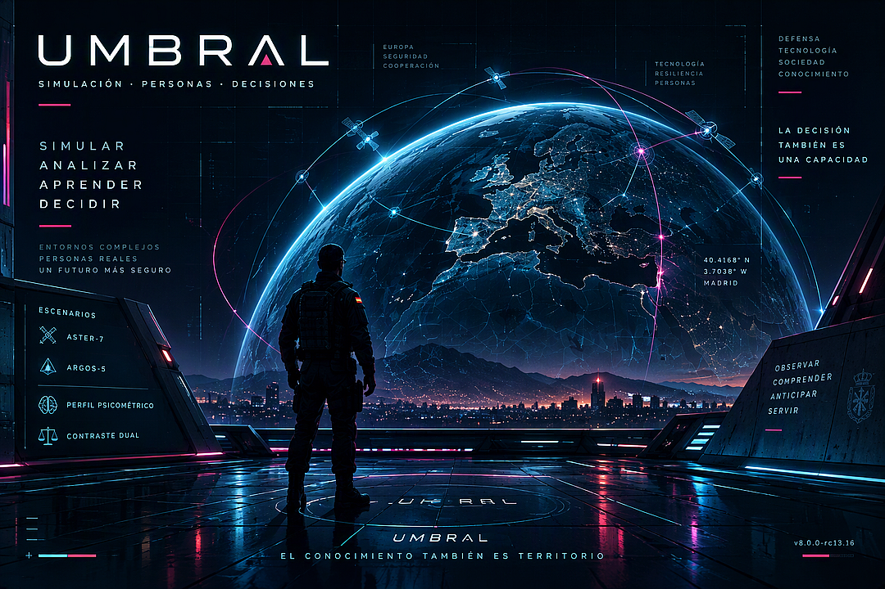

<p align="center">
  

# UMBRAL

> Un simulador puede producir una puntuación. Eso no significa que haya demostrado lo que esa puntuación parece decir.

**UMBRAL** es un prototipo web experimental para formación, simulación de decisiones y exploración de perfiles de trabajo en gestión de proyectos. Reúne dos escenarios operativos, un perfil psicométrico descriptivo y una capa de contraste entre lo que una persona declara sobre sí misma y lo que hace dentro de una simulación.

No pretende resolver una selección de personal. Tampoco disfraza una encuesta detrás de una interfaz vistosa. Su propósito es más concreto: construir un entorno donde las decisiones, sus consecuencias y sus límites de interpretación puedan observarse con trazabilidad.

La aplicación se distribuye como un único fichero HTML y funciona localmente en el navegador, sin servidor y sin instalación.

---

## Estado del proyecto

- **Versión descrita:** `8.0.0-rc13.16`
- **Formato:** aplicación web autocontenida en un único HTML
- **Estado:** prototipo formativo experimental
- **Uso previsto:** docencia, demostración, pruebas técnicas y estudio del diseño del instrumento
- **Uso no autorizado:** selección de personal, diagnóstico psicológico o clasificación profesional automática

La versión actual incorpora controles de navegación, persistencia local, trazabilidad, temporización por actividad y una puerta interna de regresión. Esa ingeniería hace el artefacto más auditable. No lo convierte por sí sola en un instrumento validado.

---

## Qué contiene UMBRAL

UMBRAL se organiza en cuatro espacios principales:

1. **ASTER-7**, simulación de gestión de un programa tecnológico en un entorno de presión operativa.
2. **ARGOS GDP-5**, simulación de dirección de proyectos con planificación, recursos, gobernanza y cambio.
3. **UMBRAL/PERFIL**, perfil descriptivo de personalidad y preferencias profesionales.
4. **Contraste Dual**, comparación entre autodescripción y evidencia observada en los escenarios.

El portal inicial separa estas experiencias. Cada una mantiene su propio estado y su propia lógica, aunque pueden compartir resultados cuando el usuario solicita el contraste.

---

# 1. Portal de acceso

El portal es la entrada a la aplicación y actúa como frontera entre módulos. No es una pantalla decorativa. Evita que una simulación iniciada contamine involuntariamente otro escenario y permite saber qué herramienta se está utilizando en cada momento.

Desde el portal se puede:

- iniciar ASTER-7;
- iniciar ARGOS GDP-5;
- abrir el perfil psicométrico;
- continuar una sesión guardada;
- descartar un autoguardado local;
- acceder al Contraste Dual cuando existen evidencias suficientes.

Si el navegador conserva una sesión incompleta, UMBRAL muestra un aviso. La copia permanece únicamente en `localStorage`, caduca a las 24 horas y se elimina al cerrar correctamente la experiencia o al descartarla.

---

# 2. ASTER-7

ASTER-7 sitúa al participante ante la dirección de un programa tecnológico sometido a restricciones de plazo, calidad, presupuesto, seguridad y coordinación. El escenario combina información documental, comunicaciones, asignación de recursos y pruebas cognitivas.

No se evalúa una respuesta aislada. Se observa una secuencia de decisiones dentro de un sistema que conserva consecuencias.

## 2.1 Bandeja E-Tray

La bandeja reúne comunicaciones con distinta prioridad, dificultad y relación con las competencias observadas. Los correos cubren, entre otras materias:

- planificación;
- riesgos;
- calidad;
- configuración;
- cumplimiento;
- liderazgo;
- seguridad;
- compras;
- coordinación técnica.

Las alternativas se presentan en orden balanceado. La letra visible no identifica una clave fija y la distribución A/B/C/D se mantiene equilibrada durante la sesión.

Algunas decisiones producen retrabajo. Otras afectan a calidad, margen, plazo, clima o reserva. La penalización no es una explicación moral. Es la representación operativa de una consecuencia definida por el escenario.

## 2.2 Documentación del proyecto

La decisión no debe salir de la intuición pura. El escenario incluye documentación sobre:

- calendario y dependencias;
- organización y cargas;
- límites financieros;
- requisitos técnicos;
- seguridad y clasificación;
- criterios de aceptación;
- protocolos de respuesta.

El participante puede consultar estos documentos durante la sesión. La interfaz registra qué documentación se ha abierto, pero no interpreta automáticamente que leer equivalga a comprender.

## 2.3 Gantt y planificación

La vista documental incorpora la secuencia temporal del proyecto y sus dependencias. Su función es dar contexto a decisiones que afectan al camino crítico, a la holgura y al uso de recursos.

No es un gestor de proyectos completo. Es el modelo mínimo necesario para que el plazo deje de ser una cifra flotante y pase a tener estructura.

## 2.4 Matriz WBS y asignación de recursos

La matriz WBS obliga a relacionar paquetes de trabajo, perfiles, restricciones y capacidad disponible. Las etiquetas de selección son deliberadamente neutras: los datos que justifican la decisión deben buscarse en los documentos, no deducirse del propio nombre de la opción.

La actividad pretende observar cómo se integran varias restricciones al mismo tiempo. No basta con identificar a la persona técnicamente más capaz si su disponibilidad, habilitación o coste impiden la asignación.

## 2.5 Batería cognitiva DELTA

ASTER-7 incluye cuatro retos breves:

1. memoria de trabajo secuencial;
2. comparación perceptiva y atención selectiva;
3. planificación espacial y enrutamiento;
4. razonamiento inductivo abstracto.

Cada reto tiene un tiempo limitado y un número máximo de intentos. Estas pruebas están gamificadas y forman parte de la presión del escenario. No deben confundirse con una batería psicométrica validada ni con una medida clínica de capacidad.

## 2.6 Avisos e interrupciones

Durante la sesión aparecen comunicaciones breves con tiempo de respuesta limitado. Su función es introducir interrupciones controladas y observar priorización bajo carga.

Una respuesta rápida no se considera automáticamente buena. Una respuesta lenta tampoco se interpreta por sí sola como falta de capacidad. La latencia se conserva como evidencia técnica, no como diagnóstico.

## 2.7 Cierre de ASTER-7

Al finalizar, el sistema genera un snapshot inmutable con:

- versión de la aplicación;
- semilla de sesión;
- correos seleccionados;
- orden de apertura;
- decisiones y eventos;
- pausas;
- cobertura de evidencias;
- resultado operativo;
- límites de interpretación.

La puntuación global solo aparece cuando la cobertura mínima está completa. Si faltan evidencias, UMBRAL lo declara. Inventar precisión no mejora un instrumento. Solo mejora su apariencia.

---

# 3. ARGOS GDP-5

ARGOS GDP-5 traslada el núcleo de UMBRAL a un proyecto de gestión más reconocible: una red itinerante de ciencia aplicada. El escenario trabaja planificación, gobernanza, compras, alcance, liderazgo y adaptación.

## 3.1 Caso de proyecto

El caso parte de seis actividades relacionadas mediante dependencias PERT. El camino crítico de referencia es `A-B-D-F`, con una rama alternativa `A-C-E-F`.

El participante debe interpretar el efecto de:

- duraciones;
- holguras;
- restricciones de recursos;
- cambios de alcance;
- decisiones de compra;
- aceptación y gobernanza.

## 3.2 PERTBOARD

PERTBOARD es la interfaz gráfica para trabajar el caso PERT. Permite razonar sobre dependencias y consecuencias sin reducir el ejercicio a rellenar una tabla.

El tablero no busca premiar la memoria de una fórmula. Busca hacer visible qué cambia cuando una actividad se retrasa, se comprime o comparte un recurso con otra.

## 3.3 Recursos y capacidad

ARGOS incorpora perfiles con distintas cargas, competencias y disponibilidades. Algunas decisiones mejoran una actividad y perjudican otra. Ahí aparece el problema real: optimizar una pieza puede empeorar el sistema.

## 3.4 Gobernanza y reserva

El escenario mantiene una reserva económica y límites de autorización. Las decisiones de gasto deben respetar el modelo de firma y cofirma definido en la documentación.

La aplicación distingue entre capacidad técnica para ejecutar una decisión y autoridad para aprobarla. Son problemas distintos. Mezclarlos suele producir errores caros.

## 3.5 WBS de ARGOS

La WBS combina paquetes de datos, automatización, gobernanza y cambio. El participante debe construir una asignación coherente con el proyecto y con los recursos disponibles.

## 3.6 Retos de dirección

ARGOS incluye decisiones específicas sobre:

- planificación;
- nivelación;
- diagnóstico;
- alertas;
- gestión del cambio.

La bandeja contiene un banco propio de comunicaciones y retrabajos. Su selección utiliza una semilla de sesión y mantiene cobertura de competencias.

## 3.7 Cierre de ARGOS

El cierre usa el mismo contrato de trazabilidad que ASTER-7. Los resultados pueden exportarse y emplearse posteriormente en el Contraste Dual.

---

# 4. Indicadores operativos

Las simulaciones trabajan con cuatro indicadores:

- **Calidad**, ponderada al 40 %.
- **Margen**, ponderado al 25 %.
- **Plazos**, ponderados al 20 %.
- **Clima**, ponderado al 15 %.

Durante una sesión real pueden permanecer ocultos para evitar que el participante juegue contra el marcador en lugar de gestionar el escenario.

Los indicadores parten de una situación inicial y reflejan consecuencias definidas por las decisiones. No representan competencias psicológicas. El resultado operativo y el perfil personal permanecen separados.

---

# 5. Modalidades de tiempo

UMBRAL ofrece dos configuraciones:

## Estándar

- turno de 25 minutos;
- retos cognitivos de 50 segundos;
- avisos de 25 segundos.

## Ampliada ×2

- turno de 50 minutos;
- retos cognitivos de 100 segundos;
- avisos de 50 segundos.

La modalidad ampliada es una adaptación funcional. No existe equivalencia demostrada entre ambas condiciones y sus resultados no deben mezclarse como si procedieran del mismo baremo.

El cronómetro utiliza tiempo monotónico y distingue las pausas del tiempo activo. Perder la visibilidad de la pestaña puede suspender la evaluación cuando el módulo lo requiere.

---

# 6. UMBRAL/PERFIL

UMBRAL/PERFIL es un módulo separado de las simulaciones. Combina:

- 50 ítems procedentes del marco IPIP;
- 24 ítems profesionales UMBRAL-PRO;
- microdilemas situacionales;
- indicadores técnicos de calidad de respuesta.

El resultado es descriptivo. No asigna aptitud laboral, no emite diagnóstico y no clasifica al participante frente a una población normativa.

## 6.1 Bloques del perfil

Los ítems se organizan por bloques y se presentan en orden reproducible mediante una semilla. La aplicación registra:

- respuestas;
- orden de presentación;
- orden de respuesta;
- tiempo activo;
- primera latencia por ítem;
- bloques completados.

## 6.2 Dimensiones

El informe representa dimensiones de personalidad y preferencias de trabajo mediante índices de 0 a 100. Esos índices describen la posición dentro de la propia escala. No significan percentiles poblacionales.

Comparar dos dimensiones entre sí puede resultar tentador. Sin baremos y sin error estándar, también puede resultar engañoso.

## 6.3 Indicadores técnicos de respuesta

El módulo observa:

- completitud;
- concentración de respuestas extremas;
- aquiescencia descriptiva;
- rachas de respuestas idénticas;
- mediana de latencia por ítem.

Estas señales permiten advertir patrones. No demuestran por sí solas simulación, desatención o falta de sinceridad.

## 6.4 Mapa psicométrico

El mapa sitúa visualmente el resultado dentro del espacio de perfiles generado por las dimensiones. Su función es facilitar lectura y comparación interna.

No es un mapa normativo de población. La posición mostrada pertenece al modelo del prototipo, no a una tipología psicológica acreditada.

## 6.5 Informe y exportación

El perfil puede:

- imprimirse;
- exportarse como JSON;
- revisarse antes de cerrar;
- enlazarse con resultados de simulación.

El snapshot conserva respuestas, tiempos, fuentes declaradas y advertencias metodológicas.

---

# 7. Contraste Dual

El Contraste Dual compara dos fuentes diferentes:

- **autodescripción**, procedente de UMBRAL/PERFIL;
- **evidencia observada**, procedente de ASTER-7 o ARGOS GDP-5.

El módulo no suma ambos resultados ni fabrica una puntuación superior. Los mantiene separados y muestra convergencias, divergencias o situaciones dependientes del contexto.

Una divergencia no implica engaño. Puede indicar presión, ambigüedad, experiencia desigual o una distancia real entre intención y conducta. El contraste abre una pregunta. No dicta la respuesta.

---

# 8. Resultados, trazabilidad y exportaciones

UMBRAL conserva una traza en memoria durante la sesión. Registra presentaciones, respuestas, eventos, pausas y cierres. Al finalizar se genera un snapshot que no se recalcula silenciosamente.

Las salidas disponibles incluyen:

- informe visible;
- impresión;
- exportación TXT en las simulaciones;
- exportación JSON técnica;
- exportación JSON del perfil;
- Contraste Dual cuando hay fuentes compatibles.

Los ficheros exportados son artefactos locales y editables. No están firmados criptográficamente y no deben utilizarse como evidencia de alta integridad.

---

# 9. Autoguardado y privacidad

UMBRAL no envía resultados a un servidor. El autoguardado utiliza `localStorage` del navegador.

Su ciclo de vida es deliberadamente limitado:

- guardado periódico de sesiones incompletas;
- restauración compatible por versión y esquema;
- caducidad a las 24 horas;
- descarte manual;
- borrado al finalizar correctamente;
- eliminación de copias inválidas o incompatibles.

Esto reduce pérdidas accidentales. No garantiza anonimato, cifrado en reposo ni protección frente a una persona con acceso al mismo navegador.

---

# 10. Accesibilidad

El artefacto incorpora:

- controles nativos cuando resulta posible;
- foco visible;
- navegación por teclado;
- nombres accesibles en diálogos;
- jerarquía de encabezados revisada;
- preferencias de tamaño de texto;
- tema de alto contraste;
- reducción de movimiento;
- controles de pausa;
- diseño adaptable.

---

# 11. Puerta interna de regresión

La puerta comprueba, entre otros aspectos:

- coherencia de versión;
- presencia de los accesos del portal;
- balance de letras;
- sesgo de longitud de opciones;
- disponibilidad del autoguardado;
- ciclo básico de almacenamiento y borrado;
- autoprueba de telemetría;
- trazas estructuradas;
- exportación portátil;
- disponibilidad del Contraste Dual.

---

# 12. Aleatorización y reproducibilidad

La selección de contenidos y la distribución de opciones utilizan semillas de sesión. Esto permite:

- variar la experiencia;
- mantener equilibrio;
- reconstruir el manifiesto de selección;
- evitar patrones triviales de respuesta.

---

# 13. Cómo ejecutar UMBRAL

1. Descarga el fichero HTML de la versión que quieras probar.
2. Ábrelo en un navegador moderno.
3. Elige una experiencia desde el portal.
4. Consulta la documentación antes de decidir.
5. Finaliza la sesión y revisa el informe.
6. Exporta el resultado si necesitas conservarlo.

No requiere servidor web. Si el navegador restringe alguna descarga o función de impresión al abrir ficheros locales, puede publicarse en un servidor estático.

---

# 14. Estructura técnica

Aunque se distribuye como un único fichero, el artefacto contiene varias capas lógicas:

```text
UMBRAL
├── Portal y navegación
├── Motor de sesión
├── ASTER-7
│   ├── Bandeja E-Tray
│   ├── Documentación y Gantt
│   ├── WBS
│   ├── DELTA 4/4
│   ├── Interrupciones
│   └── Cierre y exportación
├── ARGOS GDP-5
│   ├── Bandeja propia
│   ├── PERTBOARD
│   ├── Recursos y gobernanza
│   ├── WBS
│   └── Cierre y exportación
├── UMBRAL/PERFIL
│   ├── IPIP
│   ├── UMBRAL-PRO
│   ├── Dilemas situacionales
│   ├── Indicadores de respuesta
│   └── Informe
├── Contraste Dual
├── Persistencia local
├── Accesibilidad
└── Puerta de regresión
```


---

# 15. Alcance científico y límites

UMBRAL declara expresamente sus límites:

- no dispone todavía de baremos poblacionales;
- no acredita fiabilidad psicométrica propia;
- no ha demostrado estructura factorial de UMBRAL-PRO;
- no acredita validez de criterio;
- las claves situacionales requieren revisión experta;
- las correspondencias del Contraste Dual son experimentales;
- las latencias son indicadores técnicos, no tiempos exclusivos de procesamiento;
- la aplicación cliente no protege la clave ni firma los resultados;
- una simulación óptima no demuestra competencia general fuera del escenario.

---

# 16. Uso recomendado

UMBRAL puede resultar útil para:

- prácticas de gestión de proyectos;
- discusión de decisiones bajo presión;
- ejercicios de planificación y PERT;
- demostraciones de trazabilidad;
- docencia sobre validez de instrumentos;
- pruebas de diseño gamificado;
- investigación exploratoria, con protocolo y revisión ética adecuados.

No debe utilizarse para:

- contratar o descartar personas;
- emitir diagnósticos;
- comparar candidatos mediante baremos inexistentes;
- automatizar decisiones laborales;
- presentar índices descriptivos como rasgos acreditados.

---

# 17. Desarrollo y control de cambios

Cada release candidate se somete a revisión estática, pruebas de regresión y, cuando el entorno lo permite, ejecución mediante jsdom.

Se ha verificado:

- carga sin errores jsdom;
- gate global en verde;
- navegación contractual;
- balance A/B/C/D;
- autoguardado;
- telemetría secuencial;
- disponibilidad de exportación;
- reducción del sesgo de longitud de 35/38 a 2/38.


---

# 18. Hoja de ruta

Las siguientes líneas permanecen abiertas:

- revisión experta del contenido de los correos;
- adaptación lingüística y metodológica del perfil;
- estudio de aquiescencia y consistencia;
- detección no punitiva de patrones de respuesta;
- análisis de fiabilidad y estructura factorial;
- validación de los dilemas situacionales;
- revisión sectorial de referencias técnicas;
- pruebas de contraste en navegador real;
- modularización del fichero único;
- analítica agregada para uso docente.


---

# 19. Contribución

Las contribuciones son bienvenidas si distinguen con claridad entre:

- corrección funcional;
- mejora de accesibilidad;
- revisión de contenido;
- hipótesis psicométrica;
- evidencia empírica.

Una propuesta que cambia una clave, una penalización o una dimensión debe explicar la razón y el criterio de aceptación. Que el resultado parezca razonable no basta.

Al abrir una incidencia, incluye:

- versión exacta;
- navegador;
- módulo;
- pasos para reproducir;
- resultado observado;
- resultado esperado;
- captura o exportación, si procede;
- impacto estimado.

---

# 20. Licencia, autoría y cita

GNU GENERAL PUBLIC LICENSE

**Autor:** Manuel Hernández González  
**Proyecto:** UMBRAL  
**Versión documentada:** 8.0.0-rc13.16

---

UMBRAL intenta construir la arquitectura necesaria para que la evidencia, cuando exista, pueda discutirse y auditarse.

